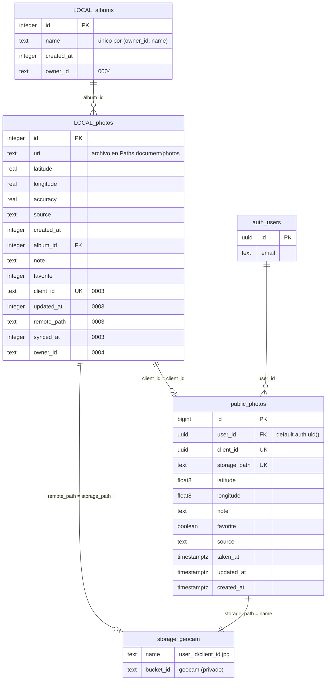
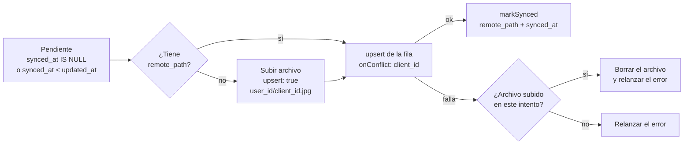
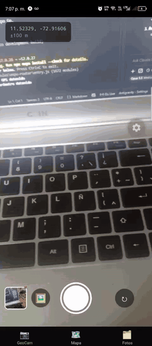
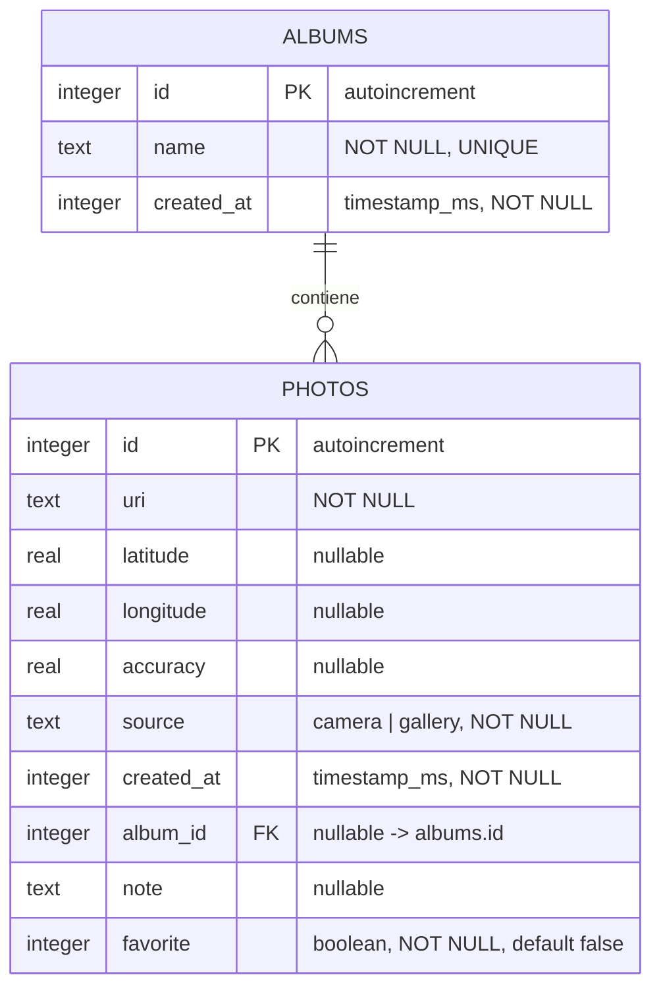

# GeoCam 📷📍

Cámara que etiqueta cada foto con coordenadas GPS, reacciona al movimiento del teléfono y guarda
todo en una base de datos local para funcionar sin conexión.
Taller Integrador 2 · **Semana 6: Módulos Nativos y Sensores** · **Semana 7: Persistencia con Drizzle ORM + SQLite** · **Semana 8: Supabase (auth, Storage, RLS y Realtime)**.

**Integrantes:** Luis Nuñez, Amand Herrera

Construida con **Expo SDK 57**, Expo Router y TypeScript estricto. Todo el acceso al hardware
está encapsulado en Custom Hooks tipados (sin `any`) que exponen los errores como estado para la UI.

## Semana 8 – GeoCam en la nube

Las fotos se pueden subir a **Supabase** (Storage + PostgreSQL) con cuenta propia. La app sigue siendo
offline-first: SQLite es la fuente de verdad en el teléfono y la nube es una copia que se sincroniza a pedido.


| Requisito | Implementación |
| --- | --- |
| T1. Cliente y credenciales | `lib/supabase.ts`, `lib/secureStorage.ts` (SecureStore por fragmentos de 1000), `.env.example` |
| T2. Autenticación | `context/AuthContext.tsx`, `app/login.tsx`, `Stack.Protected` en `app/_layout.tsx` |
| T3. Backend remoto | [`supabase/schema.sql`](supabase/schema.sql): tabla `photos` con RLS y bucket privado `geocam` |
| T4. Migración `0003` | `client_id`, `updated_at`, `remote_path`, `synced_at` en `photos` |
| T5. Subir una foto | `services/cloudPhotos.ts` + `hooks/useCloudSync.ts`; botón en el detalle e insignia ☁️ / ☁️• |
| C1. Pendientes | Botón **Sincronizar (N)** en Fotos, secuencial y con progreso ("Subiendo 3 de 7…") |
| C2. Sin duplicados ni huérfanos | Ruta fija + `upsert` del archivo y de la fila (`onConflict: 'client_id'`) y borrado compensatorio |
| C3. Borrado coherente | Nube (fila → archivo) → registro local → archivo local; sin conexión no se borra nada |
| C4. Pestaña Nube | `app/(tabs)/nube.tsx` + `hooks/useCloudPhotos.ts`: URLs firmadas y Realtime |
| C5. Datos por usuario | Migración `0004`: `owner_id` en `photos` y `albums`; todas las consultas filtran por dueño |

### Las dos bases



`LOCAL_*` son las tablas de SQLite en el teléfono; `auth_users`, `public_photos` y `storage_geocam` viven en
Supabase. El `id` autoincremental solo vale en un teléfono: lo que identifica a la misma foto en los dos
lados es el `client_id` (UUID creado en el teléfono). `owner_id` en SQLite guarda el `auth.users.id`.

### Flujo de sincronización



- **Pendiente:** nunca subida, o editada después de la última subida. Cada edición (nota, ★, álbum) renueva
  `updated_at`; `markSynced` escribe solo `remote_path` y `synced_at` y **no toca `updated_at`**.
- **Repetir es seguro:** la ruta del archivo depende solo del `client_id` y la fila usa `upsert`, así que
  sincronizar dos veces no duplica filas ni archivos. Una foto ya subida solo actualiza su fila.
- **Sincronizar (N)** sube una por una; si una falla, la anota y sigue con las demás.
- **Fotos sin archivo:** las fotos guardadas en caché antes de la C5 de la Semana 7 pueden haber perdido su
  archivo. Si nunca se subieron, no se intentan, no cuentan en N y el detalle avisa "Sin archivo".

### Borrado y comportamiento sin conexión

| La foto… | Con conexión | Sin conexión |
| --- | --- | --- |
| nunca se subió (`remote_path` nulo) | Se borra el registro y el archivo local | Igual: es solo local |
| está en la nube | Fila remota → archivo del bucket → registro local → archivo local | **No se borra nada** y se avisa |

- Si la parte remota falla, lo local no se toca: la foto sigue completa en el teléfono y se puede reintentar.
- Si se borró la fila pero falló el archivo del bucket, reintentar es seguro (borrar una fila que no existe
  no da error y vuelve a intentar el archivo).
- **Borrar todo (agitar el teléfono):** misma regla para todas a la vez. Si hay alguna foto en la nube y no
  hay conexión, se cancela todo. Nunca queda a medias.
- **Cerrar sesión no borra** los datos locales: solo los oculta. El mismo usuario los vuelve a ver al entrar.

### Datos locales por usuario y filas antiguas

Cada foto y álbum local tiene `owner_id`, y todas las consultas filtran por el usuario de la sesión. Una
segunda cuenta en el mismo teléfono ve GeoCam, Mapa, Fotos, Nube y Sincronizar vacíos.

**Decisión sobre las filas antiguas:** las fotos y álbumes creados antes de la migración `0004` no tienen
dueño. El **primer usuario que inicia sesión en el teléfono se queda con ellos** (`claimOrphans`). Se hace
una sola vez por teléfono: la marca `geocam.orphansClaimed` en SecureStore impide que un segundo usuario se
los lleve. Se eligió así porque, antes de la Semana 8, el teléfono tenía un solo usuario.

### SQL del backend

Archivo versionado: [`supabase/schema.sql`](supabase/schema.sql). Además del SQL de la guía incluye la
política `UPDATE` de `photos` y la de `storage.objects` (necesarias para el `upsert`) y la publicación en
`supabase_realtime` (pestaña Nube).

```sql
-- ===== Tabla remota de fotos =====
create table public.photos (
  id bigint generated always as identity primary key,
  user_id uuid not null default auth.uid() references auth.users (id) on delete cascade,
  client_id uuid not null unique,          -- UUID creado en el teléfono: identifica la misma foto en ambos lados
  storage_path text not null unique,
  latitude double precision,
  longitude double precision,
  note text,
  favorite boolean not null default false,
  source text not null check (source in ('camera', 'gallery')),
  taken_at timestamptz not null,
  updated_at timestamptz not null,         -- última modificación hecha por el usuario
  created_at timestamptz not null default now()
);

alter table public.photos enable row level security;

create policy "ver las mías" on public.photos
  for select to authenticated using ((select auth.uid()) = user_id);
create policy "crear las mías" on public.photos
  for insert to authenticated with check ((select auth.uid()) = user_id);
create policy "borrar las mías" on public.photos
  for delete to authenticated using ((select auth.uid()) = user_id);
-- (casa C1/C2) upsert de una foto editada después de subirla
create policy "actualizar las mías" on public.photos
  for update to authenticated
  using ((select auth.uid()) = user_id)
  with check ((select auth.uid()) = user_id);

-- (casa C4) cambios en vivo para la pestaña Nube
alter publication supabase_realtime add table public.photos;

-- ===== Bucket privado: las fotos con ubicación son datos personales =====
insert into storage.buckets (id, name, public) values ('geocam', 'geocam', false);

create policy "subir a mi carpeta" on storage.objects
  for insert to authenticated
  with check (bucket_id = 'geocam' and (storage.foldername(name))[1] = (select auth.uid()::text));
create policy "leer mi carpeta" on storage.objects
  for select to authenticated
  using (bucket_id = 'geocam' and (storage.foldername(name))[1] = (select auth.uid()::text));
create policy "borrar de mi carpeta" on storage.objects
  for delete to authenticated
  using (bucket_id = 'geocam' and (storage.foldername(name))[1] = (select auth.uid()::text));
-- (casa C2) reemplazar un archivo con upsert necesita INSERT + SELECT + UPDATE
create policy "reemplazar en mi carpeta" on storage.objects
  for update to authenticated
  using (bucket_id = 'geocam' and (storage.foldername(name))[1] = (select auth.uid()::text))
  with check (bucket_id = 'geocam' and (storage.foldername(name))[1] = (select auth.uid()::text));
```

### Cómo configurar

1. Crear un proyecto en Supabase y ejecutar [`supabase/schema.sql`](supabase/schema.sql) en el **SQL Editor**.
2. Copiar `.env.example` como `.env` y pegar los valores de **Project Settings → API Keys**: solo la URL y la
   **publishable key**. La secret key nunca va en la app. `.env` está en `.gitignore`.
3. Solo en un proyecto de práctica: **Authentication → Sign In / Providers → Email** → desactivar
   "Confirm email" para entrar sin confirmar el correo.
4. Iniciar con caché limpia para que Expo lea el `.env`: `npx expo start -c`.

### Preguntas para sustentar

_(Pendiente: las 4 preguntas de la guía de clase no están en el repositorio. Se responden aquí al tenerlas.)_

### Auditoría de credenciales

Salidas reales, ejecutadas en la rama `semana-8-supabase` el 19 de octubre de 2026:

```text
$ git log --all --full-history -- .env
(sin salida: .env nunca entró al historial)

$ git ls-files | grep -E "^\.env"
.env.example

$ git check-ignore -v .env
.gitignore:44:.env	.env

$ git grep -nE "sb_secret_|service_role|SERVICE_ROLE" -- . ':!docs/SEMANA8.md'
(sin salida)

$ git log --all -p | grep -nE "sb_secret_|service_role" | head
3312:+2. **Llaves:** en la app solo van `EXPO_PUBLIC_SUPABASE_URL` y `EXPO_PUBLIC_SUPABASE_PUBLISHABLE_KEY`. **Nunca** una secret key / `service_role` ni la contraseña de la base, con ningún nombre, en ningún archivo.
3578:+git grep -nE "sb_secret_|service_role|SERVICE_ROLE" -- . ':!docs/SEMANA8.md'   # sin resultados
3579:+git log --all -p | grep -nE "sb_secret_|service_role" | head   # sin resultados
```

Las 3 coincidencias del último comando **no son llaves**: son el texto de la guía `docs/SEMANA8.md`
(commit `68648ff`), que nombra `service_role` y `sb_secret_` para prohibirlos. El cuarto comando excluye ese
archivo, pero `git log -p` recorre todo el historial y no lo puede excluir. Como verificación extra se buscó en
todo el historial cualquier valor con forma de llave (`sb_secret_…`, `sb_publishable_…` o un JWT `eyJ…`):
el único resultado es el marcador `sb_publishable_xxxxxxxx` de `.env.example`. No hay que rotar ninguna llave.

## Semana 7 – Persistencia offline-first

Las fotos ya no viven en memoria: se guardan en SQLite (`geocam.db`) con **Drizzle ORM** y sus archivos se
copian a la carpeta de documentos de la app. Al cerrar y reabrir Expo Go, o en modo avión, todo sigue ahí.



### Funcionalidades nuevas

| Requisito | Implementación |
| --- | --- |
| Persistencia de fotos | `db/schema.ts` + `db/repositories/photos.ts` + `hooks/usePhotos.ts` (`useLiveQuery`) |
| C1. Álbumes | Tabla `albums`; crear, renombrar y eliminar desde la pestaña **Fotos** (mantener presionado un álbum) |
| C2. Segunda migración | `drizzle/0001_*.sql`: tabla `albums` + columnas `album_id`, `note`, `favorite`, sin perder fotos |
| C3. CRUD completo | `app/foto/[id].tsx`: nota, favorita, mover de álbum y eliminar |
| C4. Búsqueda y filtros reactivos | Pestaña **Fotos**: búsqueda por nota, chips de álbum / "Sin álbum" / ★ Favoritas |
| C5. Archivos permanentes | `services/photoFiles.ts`: copia a `Paths.document/photos`; el archivo se borra con su registro |

### Diagrama de tablas



Una foto pertenece como máximo a un álbum. Si se elimina un álbum, sus fotos quedan **sin álbum** (no se borran).

### Arquitectura por capas

```
Pantalla (app/)  →  Hook (hooks/)  →  Repositorio (db/repositories/)  →  Drizzle + esquema (db/)  →  expo-sqlite
                         └→ Servicio de archivos (services/photoFiles.ts) → expo-file-system
```

- **Ninguna pantalla ni componente importa `drizzle-orm` ni `@/db`.** La única excepción es `app/_layout.tsx`,
  que ejecuta `useMigrations` y muestra un indicador de carga hasta que la base está lista.
- Los **repositorios** devuelven las consultas de lectura **sin ejecutar**; los **hooks** las ejecutan con
  `useLiveQuery`, que vuelve a consultar cuando cambia la tabla (requiere `enableChangeListener: true`).
- Los hooks convierten las filas planas al tipo de dominio `GeoPhoto` (`types/geo.ts`), así que las pantallas
  no dependen de Drizzle.
- `db/client.ts` abre la base con `openDatabaseSync('geocam.db', { enableChangeListener: true })` y ejecuta
  `PRAGMA foreign_keys = ON`, porque SQLite no aplica llaves foráneas si no se activa en cada conexión.

```
db/
  client.ts                 → conexión + PRAGMA (WAL, foreign_keys) + instancia de Drizzle
  schema.ts                 → tablas albums y photos, tipos inferidos
  repositories/photos.ts    → listQuery, withLocationQuery, filteredQuery, detailQuery, create, update, remove…
  repositories/albums.ts    → listQuery, create, rename, remove (transacción)
  devSeed.ts                → solo desarrollo: datos de prueba y medición (reto)
drizzle/                    → migraciones generadas por drizzle-kit (versionadas, NO se editan)
  0000_*.sql, 0001_*.sql, 0002_*.sql, meta/, migrations.js
hooks/
  usePhotos.ts              → lista filtrada + fotos con ubicación + addPhoto/removePhoto/clearAll
  usePhoto.ts               → detalle reactivo + updateNote/toggleFavorite/moveToAlbum/remove
  useAlbums.ts              → álbumes + createAlbum/renameAlbum/removeAlbum
  useAlbumsVersion.ts       → refresca las consultas de fotos (que hacen join) al cambiar albums
  useDevTools.ts            → menú ⚙️ Dev de la pestaña Fotos (solo __DEV__)
services/
  photoFiles.ts             → persistPhoto / deletePhotoFile (API File, Directory, Paths)
```

### Migraciones

Las migraciones **se generan, nunca se escriben ni se editan a mano**:

```bash
# 1. Modifica db/schema.ts
# 2. Genera el SQL en drizzle/ (también actualiza drizzle/migrations.js)
npm run db:generate          # = npx drizzle-kit generate
# 3. Recarga la app: useMigrations aplica las pendientes al iniciar
```

> ⚠️ **No uses `npx drizzle-kit push`.** `push` modifica una base directamente sin dejar historial; en la app
> las migraciones se aplican en el teléfono a partir de los archivos versionados en `drizzle/`.

| Migración | Qué hace |
| --- | --- |
| `0000_nostalgic_blonde_phantom.sql` | Crea la tabla `photos` (uri, coordenadas `real`, origen, fecha). |
| `0001_daily_inertia.sql` | Crea `albums` (con índice único en `name`) y agrega `album_id`, `note` y `favorite` a `photos` con `ALTER TABLE … ADD`, por lo que las fotos existentes se conservan (`favorite = false`, el resto `NULL`). |
| `0002_modern_dagger.sql` | Reto: `CREATE INDEX photos_created_at_idx ON photos (created_at)` para la lista ordenada por fecha. |

> **Nota:** `drizzle-kit` generó `album_id … REFERENCES albums(id)` **sin** `ON DELETE SET NULL` (la cláusula
> solo quedó en el snapshot). Por eso `albumsRepo.remove` desvincula las fotos y borra el álbum dentro de una
> transacción; así funciona igual en la base real. Detalles en el [AI-LOG de la Semana 7](docs/ai-log/AI-LOG-semana-7.md).

### Reto: índice en `created_at` y medición

En desarrollo, la pestaña **Fotos** muestra un botón **⚙️ Dev** (`hooks/useDevTools.ts` → `db/devSeed.ts`) con tres
acciones: insertar 1000 fotos ficticias (en lotes de 100 dentro de una transacción, coordenadas aleatorias cerca de
Riohacha), medir la lista (`console.time('listar 1000 fotos')` sobre `photosRepo.listQuery()`, promedio de 5
consultas) y borrar los datos de prueba.

| Medición (Android, Expo Go, 1003 filas) | Promedio de 5 consultas |
| --- | --- |
| Sin índice (migraciones `0000` + `0001`) | **118.8 ms** |
| Con índice (`0002`) | **105.5 ms** |

`EXPLAIN QUERY PLAN` de la consulta de la lista (`LEFT JOIN albums … ORDER BY created_at DESC`):

```
Sin índice:  SCAN photos
             SEARCH albums USING INTEGER PRIMARY KEY (rowid=?) LEFT-JOIN
             USE TEMP B-TREE FOR ORDER BY          ← ordena todas las filas en memoria
Con índice:  SCAN photos USING INDEX photos_created_at_idx
             SEARCH albums USING INTEGER PRIMARY KEY (rowid=?) LEFT-JOIN
```

**Interpretación:** el índice elimina el ordenamiento en memoria, pero con 1000 filas la mejora medida es pequeña
(~11 %). La mayor parte del tiempo es pasar las filas de SQLite a JavaScript, y entre las dos mediciones también se
activó el modo WAL y se reinició Expo Go, así que no toda la diferencia es del índice. La ventaja del índice crece con
el número de filas y es mayor cuando se usa `LIMIT` (paginación), porque SQLite puede detenerse sin leer toda la tabla.

> **Modo WAL:** `db/client.ts` ejecuta `PRAGMA journal_mode = WAL`. Al aplicar la `0002` en el teléfono apareció
> `database is locked`: conexiones de recargas anteriores de Expo Go con lecturas a medias bloqueaban el `COMMIT`.
> En WAL los lectores no bloquean a quien escribe. Ver el [AI-LOG de la Semana 7](docs/ai-log/AI-LOG-semana-7.md).

## Funcionalidades (Semana 6)

| Requisito | Implementación |
| --- | --- |
| Cámara con permisos | `hooks/useCamera.ts` + `components/PermissionPrimer.tsx` |
| Ubicación con permisos y seguimiento | `hooks/useGeoLocation.ts` |
| R1. Estado global de fotos | Semana 6: `GeoPhotosContext` en memoria → Semana 7: `hooks/usePhotos.ts` sobre SQLite |
| R2. Importar desde galería | `lib/photos.ts` → `launchImageLibraryAsync({ mediaTypes: ['images'] })`, `source: 'gallery'` (borde morado) |
| R3. Pestaña Mapa | `app/(tabs)/mapa.tsx`: un `Marker` por foto, miniatura al tocar, lista "Sin ubicación" |
| R4. Agitar para borrar | `hooks/useShake.ts` → `Alert` de confirmación |
| Reto: ubicación aproximada | `useGeoLocation().isApproximate` (precisión > 1 km) muestra aviso |

## Estructura

```
app/_layout.tsx             → aplica migraciones (useMigrations) antes de montar el Stack
app/index.tsx               → redirige a /geocam
app/(tabs)/_layout.tsx      → Tabs
app/(tabs)/geocam.tsx
app/(tabs)/mapa.tsx
app/(tabs)/fotos.tsx        → búsqueda, filtros y álbumes (Semana 7)
app/foto/[id].tsx           → detalle y edición de una foto (Semana 7)
components/AlbumNameModal.tsx
components/Chip.tsx
components/PhotoImage.tsx   → imagen con placeholder si el archivo ya no existe
components/PermissionPrimer.tsx
components/StatusBanner.tsx
constants/theme.ts
db/, drizzle/, services/    → ver "Arquitectura por capas"
hooks/useCamera.ts
hooks/useGeoLocation.ts
hooks/useShake.ts
hooks/usePhotos.ts, usePhoto.ts, useAlbums.ts, useAlbumsVersion.ts
lib/permissions.ts          → mapPermission(): respuesta de Expo → PermissionState
lib/photos.ts
types/geo.ts
```

## Máquina de estados de permisos

```
checking -> undetermined -> (acepta) -> granted
                         -> (rechaza) -> denied -> (rechaza de nuevo) -> blocked
blocked -> Linking.openSettings() -> (lo activa en Ajustes) -> granted
```

`lib/permissions.ts` traduce `{ status, granted, canAskAgain }` a `PermissionState`.
Cuando `canAskAgain === false` el estado es `blocked` y la UI muestra **"Abrir Ajustes"**.
Al volver a la app (`AppState` → `active`) los hooks vuelven a *consultar* (no pedir) el permiso,
de modo que si el usuario lo activó en Ajustes la pantalla pasa sola a `granted`.

## Capturas de los tres estados de permiso

| Concedido | Rechazado | Bloqueado |
| :---: | :---: | :---: |
|  |  |  |
| Cámara y ubicación concedidas: coordenadas en vivo (±6 m) | Ubicación rechazada: la cámara sigue funcionando, la foto se guarda sin coordenadas (∅) y el banner lo comunica | Cámara bloqueada: botón **"Abrir Ajustes"** y alternativa "Importar desde galería" |

> Capturas tomadas en un iPhone físico con Expo Go. En iOS el sistema da **una sola oportunidad**:
> al primer "No permitir", `canAskAgain` pasa a `false` y el estado va directo a `blocked`, por eso
> el banner de ubicación rechazada ofrece "Abrir Ajustes". En Android se ve primero `denied`
> ("Permitir ubicación") y solo tras el segundo rechazo `blocked`.

## Checklist de entrega

- [x] **Permisos en contexto, nunca al abrir.** Al montar, los hooks solo llaman a
  `getForegroundPermissionsAsync` / `useCameraPermissions` (consulta). El diálogo del sistema
  aparece solo al tocar "Permitir acceso" o el banner de ubicación.
- [x] **Si niegas la ubicación, la cámara sigue funcionando** y un banner lo comunica;
  la foto se guarda con `coords: null` y aparece en "Sin ubicación" en el Mapa.
- [x] **Botón "Abrir Ajustes"** en `PermissionPrimer` (cámara) y en el banner (ubicación) cuando
  el estado es `blocked`.
- [x] **Todas las suscripciones se limpian al salir de la pantalla.** Las pestañas no se desmontan,
  así que las pantallas pasan `useIsFocused()` como `enabled` a `useGeoLocation` y `useShake`;
  al perder el foco el efecto hace `subscription.remove()` (con bandera `cancelled` contra la
  condición de carrera) y la `CameraView` se desmonta. En desarrollo se registra
  `[useGeoLocation] cleanup: GPS detenido` y `[useShake] cleanup: acelerómetro detenido`.
- [x] **Hooks tipados, sin `any`** (`@typescript-eslint/no-explicit-any: error`), con `error: string | null`
  en el estado que retorna cada hook.

## Ejecutar

```bash
npm install
npx expo start          # escanea el QR con Expo Go (teléfono físico)
# o, si el teléfono no está en la misma red:
npx expo start --tunnel
```

Verificaciones:

```bash
npx tsc --noEmit
npx expo lint
```

Para instalar módulos nuevos usa siempre `npx expo install <paquete>` (no `npm install`).

### Cómo probar cada estado

1. **Concedido:** abre GeoCam → "Permitir acceso" → acepta. Toca el banner amarillo → acepta la ubicación.
2. **Rechazado:** borra los datos de Expo Go (o reinstala) y rechaza el diálogo una vez.
3. **Bloqueado:** en Android, rechaza la cámara dos veces; en iOS basta un rechazo.
   Aparece "Abrir Ajustes"; actívalo allí y vuelve: la cámara se abre sola.
4. **Limpieza:** con la consola de Metro abierta, cambia a la pestaña Mapa y verifica el log de cleanup.
5. **Shake:** agita el teléfono con fotos guardadas → confirma el borrado.

## Notas

- En Expo Go se ven los textos de permiso genéricos de Expo Go; los de `app.json` solo aparecen en builds propios.
- Solo se pide ubicación en **primer plano** (`requestForegroundPermissionsAsync`).
- Escribir coordenadas en el EXIF requiere módulos fuera de Expo Go; por eso las coordenadas se guardan en
  columnas `real` de la tabla `photos` (Semana 7).
- Si la base queda inconsistente durante el desarrollo, **no borres migraciones**: borra los datos de Expo Go
  en el teléfono. La historia de `drizzle/` no se reescribe.
- En producción, `react-native-maps` en Android necesita una API key de Google Maps.
